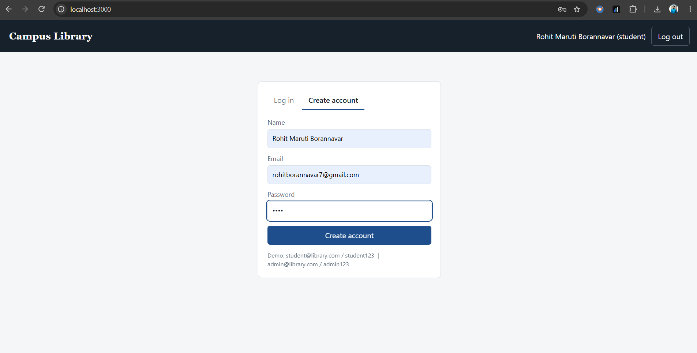
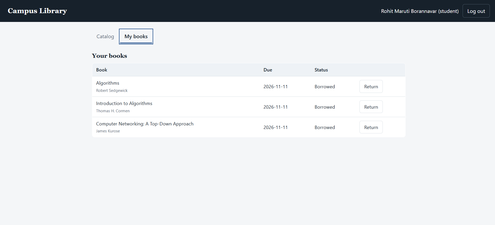
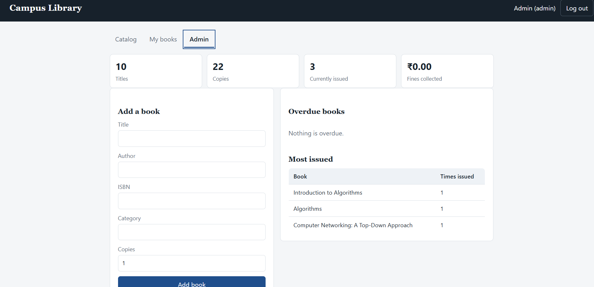

# Campus Library Management System

A full-stack web app where students search and borrow books, and admins manage the catalog and track overdue books and usage.

**Tech stack:** Node.js, Express, MySQL, JWT authentication, bcrypt, HTML/CSS/JavaScript

---

## Screenshots

### Login


### Catalog (student view)


### My books


### Admin dashboard


---

## Features

**Students**
- Register and log in (JWT based)
- Search books by title, author or ISBN, filter by category and availability, paginated results
- Search autocomplete while typing
- Borrow and return books (14-day loan, maximum 3 books at a time)
- Late fine of Rs 2 per day, calculated on return
- "Recently viewed" list of the last 5 books opened

**Admins**
- Add, edit and delete books
- Overdue report with running fine per student
- Stats: total titles and copies, books currently issued, fines collected, issues per category, most issued books

**Security and reliability**
- Passwords stored as bcrypt hashes
- All SQL queries are parameterized (protects against SQL injection)
- Role-based access: admin routes are blocked for students
- User-provided text is escaped in the UI (protects against XSS)
- Borrowing uses a **database transaction with a row lock** (`SELECT ... FOR UPDATE`), so two students cannot take the last copy at the same time

---

## Data structures and SQL used

| Concept | Where | Why |
|---|---|---|
| Trie (hand-written) | `src/utils/trie.js` | Fast prefix lookup for search autocomplete |
| LRU cache (hand-written, Map based) | `src/utils/lru.js` | Keeps each user's last 5 viewed books, evicts the oldest |
| Transactions and row locking | `src/routes/issues.js` | Prevents double issuing of the last copy |
| JOIN, GROUP BY, aggregates | `src/routes/issues.js` | Overdue report, stats, most issued books |
| Indexes and CHECK constraint | `schema.sql` | Faster queries and valid copy counts |

### Database design

```
users (id, name, email, password_hash, role, created_at)
books (id, title, author, isbn, category, total_copies, available_copies, created_at)
issues (id, user_id, book_id, issued_at, due_date, returned_at, fine)

users 1 --- N issues N --- 1 books
```

---

## Project structure

```
library-management/
├── schema.sql              # database tables, indexes, constraints
├── src/
│   ├── server.js           # Express app entry point
│   ├── db.js               # MySQL connection pool
│   ├── initDb.js           # creates database and tables
│   ├── seed.js             # sample books and demo users
│   ├── middleware.js       # JWT auth and admin-only guards
│   ├── routes/
│   │   ├── auth.js         # register, login
│   │   ├── books.js        # catalog, search, autocomplete, admin CRUD
│   │   └── issues.js       # borrow, return, overdue, stats
│   └── utils/
│       ├── trie.js
│       ├── lru.js
│       └── fine.js
├── public/                 # frontend (index.html, style.css, app.js)
├── tests/utils.test.js     # unit tests
├── Dockerfile
└── docker-compose.yml
```

---

## Getting started

**Requirements:** Node.js 18+ and MySQL 8

1. Clone the repository and install dependencies
   ```bash
   git clone https://github.com/rohi-del/library-management-system.git
   cd library-management-system
   npm install
   ```
2. Create your environment file from the template
   ```bash
   cp .env.example .env
   ```
   Open `.env` and set your MySQL password and a long random `JWT_SECRET`. You can generate one with:
   ```bash
   node -e "console.log(require('crypto').randomBytes(32).toString('hex'))"
   ```
3. Create the database and tables
   ```bash
   npm run db:init
   ```
4. Add sample data
   ```bash
   npm run seed
   ```
5. Start the app
   ```bash
   npm start
   ```
   Open http://localhost:3000

**Demo accounts (local use only):**
- Admin: `admin@library.com` / `admin123`
- Student: `student@library.com` / `student123`

### Run with Docker

```bash
docker compose up --build
docker compose exec app npm run seed
```

Then open http://localhost:3000

---

## Running tests

```bash
npm test
```

Unit tests cover the Trie, the LRU cache and the fine calculation.

---

## API overview

| Method | Endpoint | Access |
|---|---|---|
| POST | `/api/auth/register`, `/api/auth/login` | Public |
| GET | `/api/books?q=&category=&available=1&page=` | Logged in |
| GET | `/api/books/suggest?prefix=`, `/api/books/recent`, `/api/books/categories`, `/api/books/:id` | Logged in |
| POST, PUT, DELETE | `/api/books`, `/api/books/:id` | Admin |
| POST | `/api/issues` (body: `book_id`) | Logged in |
| POST | `/api/issues/:id/return` | Owner or admin |
| GET | `/api/issues/mine` | Logged in |
| GET | `/api/issues/overdue`, `/api/issues/stats` | Admin |

---

## What I learned

> Edit this section in your own words before publishing. Interviewers read it.

- How a borrow request flows from the browser, through the Express route and middleware, to the database
- Why a transaction with a row lock is needed when two users act on the same row at the same time
- How a Trie gives prefix search without scanning every title, and how an LRU cache evicts the oldest item
- Setting up MySQL locally, including fixing the "Access denied" error by resetting the root password
- Keeping secrets out of Git using `.env` and `.gitignore`

## Future improvements

- Email reminders before the due date
- Reservation queue when no copies are available
- React frontend
- API tests with Supertest
- Live deployment

---

## Author

**Rohit Borannavar** | [GitHub](https://github.com/rohi-del) | rohitborannavar7@gmail.com
